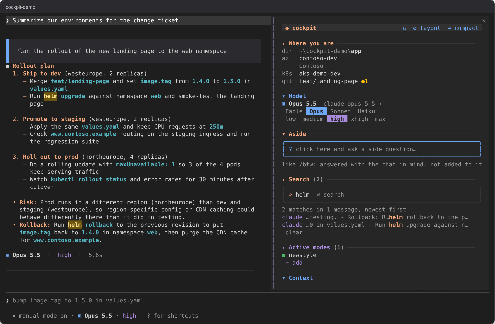

# claude-code-cockpit

A Claude Code mod for the terminal. It adds two things:

- an **operational side panel** that shows where you are (folder, Azure, Kubernetes, git), which model you are using, how full the context is, what is running in Azure DevOps and what you changed in the session;
- a **chat that is easier to read**: boxed prompts, coloured headings and lists, tables with a header and stripes, code blocks with a **Copy code** button, and a thin line between turns.

The look is inspired by OpenCode.


## Install

At the prompt of a Claude Code terminal session:

```
/plugin install cockpit --marketplace xlollx/claude-code-cockpit
```

From a shell:

```
claude plugin install cockpit --marketplace xlollx/claude-code-cockpit
```

The panel opens by itself in new sessions (turn that off with `openOnStart`).

## Commands

| Command | What it does |
|---|---|
| `/cockpit` (alias `/sidebar`) | opens the side panel again after you closed it with `×` |
| `/newstyle off` | turns the whole look off: panel and chat styling. `/newstyle on` turns it back on. The choice is remembered across sessions |

## The side panel


The panel sits on the right of the chat when the terminal is wide enough (about 110 columns or more). In a narrow terminal it becomes a two-line bar above the prompt.

- **Click a section title** to fold or unfold it. Folded sections are remembered across sessions.
- Sections with nothing to show (no PR, no pipelines, no reminders) stay hidden.
- Hide sections you never want with the `hiddenSections` option.
- At the bottom edge: `● Claude Code <version>`, always pinned there while the sections scroll.

The sections, from top to bottom:

### Where you are

- **dir**: the current folder (`~` for your home).
- **az**: the Azure subscription and tenant you are logged into (read from the Azure CLI profile files, no `az` call).
- **k8s**: the kubectl context and namespace (read from the kubeconfig file).
- **git**: the branch, `●N` uncommitted changes, `↑N` commits to push and `↓N` to pull.

Production is easy to spot: a subscription, context or branch whose name matches `prodPattern` (default `prod`, never `noprod`/`nonprod`) turns **red**; `main` and `master` turn **yellow**. The section is checked again every 30 seconds, so an `az account set` or `kubectl config use-context` done in another terminal shows up by itself.

### Model

- One button per model family (`Fable`, `Mythos`, `Opus`, `Sonnet`, `Haiku`...). One click switches model. A new family appears by itself as soon as it is used, or when an agent in `~/.claude/agents` names it in `model:`.
- `…` opens Claude Code's full model picker.
- `low medium high xhigh max`: one click sets the effort.
- Under them, the exact model id in use.

### Search

Type text in the field and press **Enter**: the panel lists every occurrence in the session's messages (your prompts and Claude's replies), newest first, with the match highlighted.

- **Click a hit** to scroll the chat to that message.
- While a search is on, its occurrences are **highlighted in the chat** too (prompts, replies, headings, tables; not inside code blocks).
- `clear` removes the search and the highlight.
- **Esc** gives the keyboard back to the prompt.



### Active modes

Shows which style modes are on, so you never wonder why Claude is answering in a certain way:

- `newstyle` (this mod's look);
- the mode skills `i-have-adhd`, `caveman` (with `ultracave`/`megacave`) and `ponytail` (with its level), turned on with `/skill` or in words ("adhd mode on", "caveman mode off");
- `ultracode`, when the last prompt contains it.

`✕` next to a skill puts the phrase that turns it off into the prompt. A skill named `panic`, run without arguments, clears the list.

### Context

- A fill bar with the percentage of the context window in use, and the tokens (`112k/1000k`).
- Your 5-hour and 7-day usage limits.
- How long the session has been running.
- At 80% a toast suggests `/compact` before a long task.

### Pipelines (Azure DevOps)

Runs **you** requested in the last 24 hours, however they were started: portal, `az pipelines run`, REST, a pull request.

- By default only the runs that need attention: **⏳ running or queued**, **⏸ waiting for approval**, **✗ failed**. `pipelinesShow: all` shows every run, finished ones included (✓ succeeded, ⚠ partially succeeded, ⊘ cancelled).
- At most 4 runs (`pipelinesMax`), each with name, run number, branch and age.
- Refreshed every minute.
- Watched projects: the current repo's (when its remote is on Azure DevOps), any project named in a command you run, and those listed in `adoProjects`.
- **Display only**: the mod sends GET requests and never starts, cancels or approves anything.
- Needs `az login`; the mod asks the Azure CLI for a token of the organization's tenant.

### Pull request

The open pull request of the current branch, on GitHub or Azure DevOps: number, title, draft, reviews (✓ approved, ✗ changes requested or rejected, ⏸ waiting) and the CI result.

- **Display only**: GET requests, never a change to the pull request.
- Uses the credential git already holds (Git Credential Manager) and never prompts for a login.
- Refreshed every 2 minutes, when the branch changes and after a `git push`.

### Tasks

Claude's task list for the session (`TaskCreate`/`TaskUpdate`, or `TodoWrite`): in progress ▶ first, then pending ○, then done ✓, with the done/total count in the title.

### Quick actions

| Button | What it does |
|---|---|
| `Compact` | runs `/compact` |
| `Context` | runs `/context` (detailed context usage) |
| `Copy path` | copies the current folder's path to the clipboard |
| `Paste image` | saves the image in the clipboard as a PNG (in `%TEMP%\claude-cockpit\` on Windows) and writes its path into the prompt. Also works with an image **file** copied in Explorer. Useful when you want the image as a file on disk, or the clipboard holds a file rather than pixels |

### Write commands

The commands of this session that have effects **outside your machine**, with time and ✓/✗ result, so you can see at a glance what you changed:

| Tool | Recognised |
|---|---|
| OpenTofu / Terraform | `apply`, `destroy`, `import`, `taint`, `untaint`, `force-unlock`, `state rm/mv/push` |
| Azure CLI | `az ... create/delete/update/set/assign/start/stop/restart/deallocate/purge/import/invoke/add/remove/upgrade/failover/swap` |
| Az / Graph PowerShell | `Set-`, `New-`, `Remove-`, `Update-`, `Start-`, `Stop-`, `Restart-` `Az*` / `Mg*` cmdlets |
| kubectl / helm / flux | `kubectl apply/delete/patch/scale/rollout restart/edit/create/replace/annotate/label/drain/cordon/uncordon`, `helm install/upgrade/uninstall/rollback`, `flux reconcile/suspend/resume` |
| git / GitHub | `git push`, `gh pr create/merge/close`, `gh release create`, `gh repo create/delete/edit` |
| REST | `curl`, `Invoke-RestMethod`, `Invoke-WebRequest`, `az rest` with POST, PUT, PATCH or DELETE |
| MCP tools | tools that write, such as `kubectl_apply` or `repo_create_branch` |

A command counts only where it starts a command (`grep "git push"` or a commit message that mentions `tofu apply` does not). The title turns red as soon as there is one.

### Reminders

Open reminders due within 7 days, read from a JSON file (see [Optional integrations](#optional-integrations)); overdue ones in red. Each has two buttons that update the file:

- `✓ done` marks it done;
- `+1 day` moves it one day later.

### Edited files

The files Claude edited in the session, with how many times (`×3`).

## The chat


| Element | Look |
|---|---|
| Your prompts | box with a blue bar on the left and a slightly lighter background |
| `/command` output | orange bar (red on error) |
| Short heading lines | bold orange |
| Numbered and bulleted lists | coloured numbers, sub-items indented, a blank line between items that have sub-items |
| `inline code` | soft teal instead of Claude Code's periwinkle (`inlineCodeColor` to change it) |
| Prose | uses the whole chat width, or wraps at `proseWidth` columns |
| Code blocks | box with a green bar, the language name, syntax highlighting, and a **`⧉ Copy code`** button under it |
| Tables | outer border, coloured header, striped rows; columns shrink and wrap when the table is wider than the chat; a **`⧉ Copy table`** button under it |
| Under the prompt | `▣ Opus 5.5 · high` before Claude Code's own hint line, as OpenCode shows model and agent under its input |
| End of turn | `▣ Opus 5.5 · high · 40s` and a thin line between one turn and the next |

### Copy code

Click `⧉ Copy code` under any code block to copy its content, without the box, the language name or the indentation of the reply. It works for blocks inside a list too. A toast confirms how many lines were copied.

### Copy table

Click `⧉ Copy table` under any table: it is copied **as a real table**, so pasting into Teams, Outlook, Word or Excel gives rows and columns, not pipes and dashes.

- Windows: HTML plus tab-separated text, through PowerShell.
- macOS: HTML plus text, through `osascript` (not tested yet).
- Linux: HTML through `wl-copy` (Wayland) or `xclip` (X11) (not tested yet).

## Options

Set them in `/config` (the plugin's rows) or in `settings.json` under `pluginConfigs.cockpit.options`:

| Option | Default | What it does |
|---|---|---|
| `palette` | `dark` | `light` for terminals with a light background |
| `proseWidth` | `0` | wrap reply text at this column (40 or more, e.g. `100` for shorter lines); `0` uses the whole chat width |
| `hiddenSections` | empty | panel sections to hide, comma separated: `search`, `pipelines`, `where`, `model`, `modes`, `context`, `pr`, `tasks`, `actions`, `writes`, `reminders`, `files` |
| `prodPattern` | `prod` | regular expression that marks a subscription, kubectl context or branch as production (`noprod`/`nonprod` never match) |
| `openOnStart` | `true` | open the panel when a session starts |
| `inlineCodeColor` | empty | colour of `inline code` in replies, as `#rrggbb` (default: soft teal `#7fd6c2` on dark, `#0f766e` on light) |
| `adoProjects` | empty | extra Azure DevOps projects to watch for pipeline runs, comma separated as `org/project` |
| `pipelinesShow` | `active-failed` | `all` shows every run of the last 24 hours, not only running, waiting and failed ones |
| `pipelinesMax` | `4` | how many pipeline runs the panel shows at most |

Example:

```json
"pluginConfigs": {
  "cockpit": {
    "options": { "proseWidth": 100, "hiddenSections": "files,tasks", "adoProjects": "contoso/Platform" }
  }
}
```

## Optional integrations

None of these is required; each section stays hidden or empty when its source is missing.

- **Reminders**: put a JSON list in `~/.claude/reminders.json` (or the file named by the `COCKPIT_REMINDERS_FILE` environment variable). `due` is local time:

  ```json
  [{ "id": "renew-cert", "due": "2026-12-01T09:00", "title": "Renew the TLS certificate", "done": false }]
  ```

- **Azure** is read from `AZURE_CONFIG_DIR` (default `~/.azure`) and **Kubernetes** from `KUBECONFIG` (default `~/.kube/config`): files only, no CLI call.
- **Pipelines** need the Azure CLI (`az login`).
- **Pull requests** need git credentials for GitHub or Azure DevOps already stored by Git Credential Manager.
- **Active modes** follows the skills `i-have-adhd`, `caveman` and `ponytail` when they are installed; other skills are not tracked.

## Extras

`extras/windows-terminal-ember-dark.json`: the "Ember Dark" colour scheme for Windows Terminal, with an Obsidian-like `#1E1E1E` background. Paste it into `schemes` in Windows Terminal's `settings.json` and pick it in the profile. In Claude Code, `/theme` -> "Dark mode (ANSI colors only)" uses the terminal palette.

## Known limits

These come from what Claude Code lets a mod change:

- The prompt box and the height of the docked panel cannot be restyled.
- `!` shell rows and the `❯ /command` row are drawn by Claude Code and keep their default look.
- MCP server status is not available to mods.
- A dropdown keeps the keyboard until Esc, so model and effort are buttons.
- Claude Code's markdown ignores blank lines inside lists, so the mod draws lists itself.
- Modes turned on before the mod loaded are not shown until you run the skill again.
- Images are not drawn inside the chat in Windows Terminal (only kitty, Ghostty and iTerm2 support them).

## Development

Clone the repository and load the folder in every session with `CLAUDE_CODE_PLUGIN_DIRS` in the `env` block of your user `settings.json`, or start Claude Code with `claude --plugin-dir <folder>`. Changes reload at the end of each turn. After a change run `claude plugin validate <folder>`. `tsconfig.json` extends the types Claude Code writes into `.claude-plugin/types/` the first time it loads the mod.

## Roadmap

Planned ideas and improvements: [ROADMAP.md](ROADMAP.md).

## License

AGPL-3.0, see [LICENSE](LICENSE).
