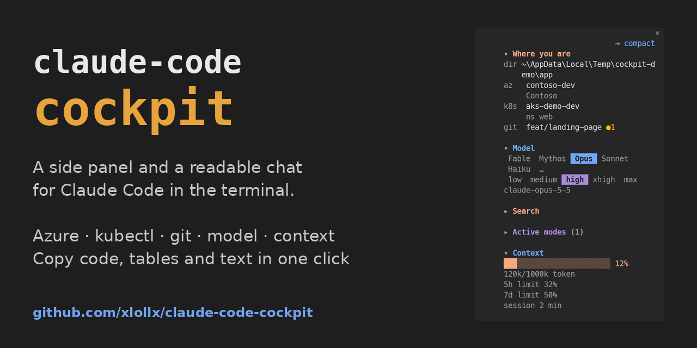
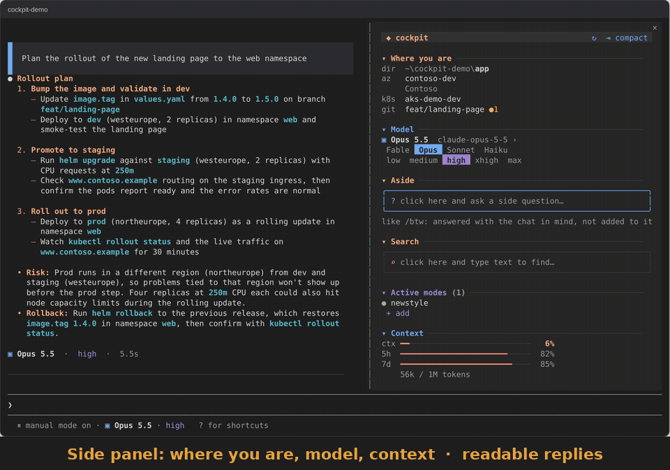
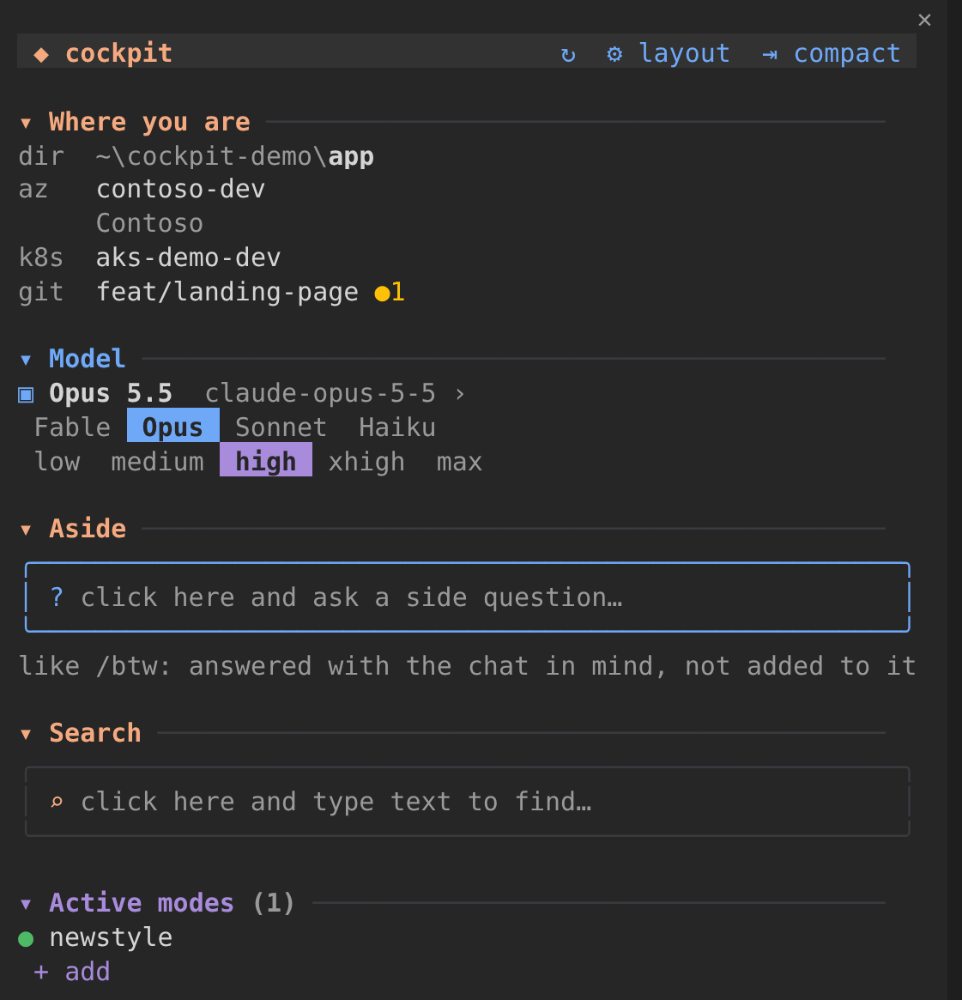
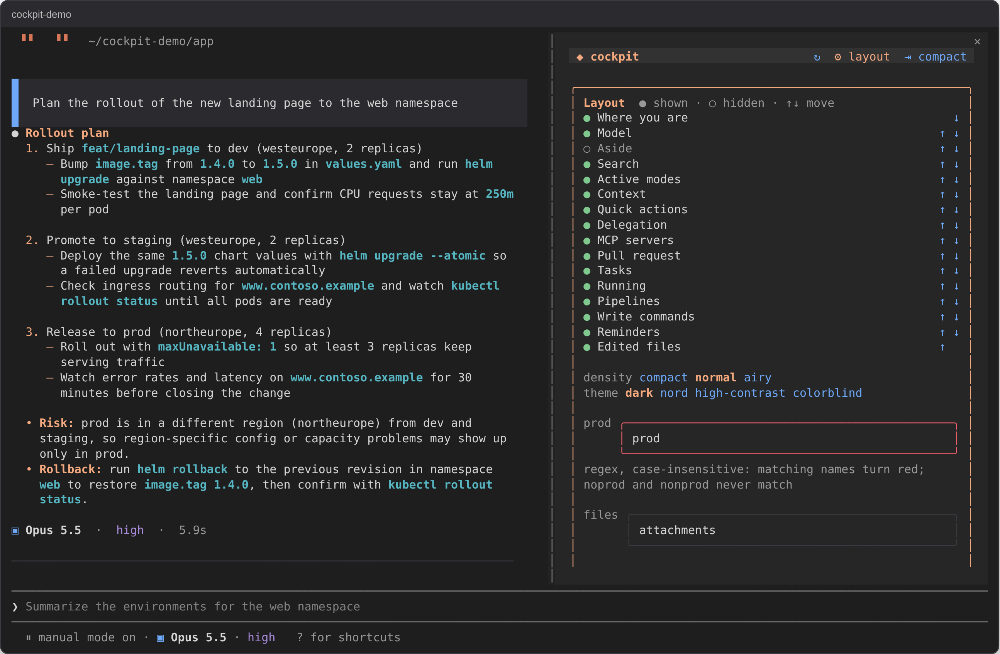
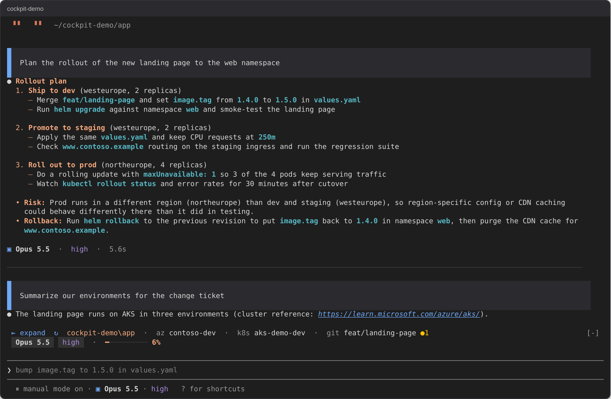
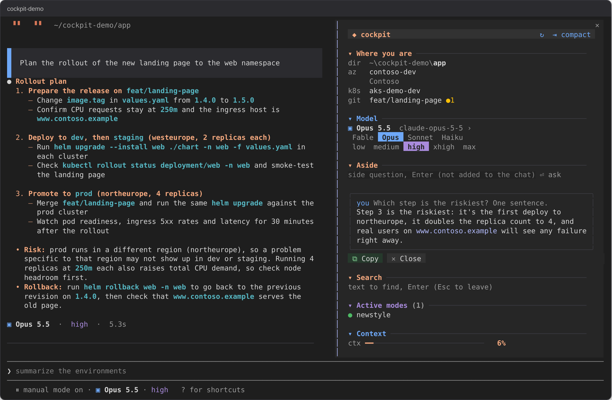
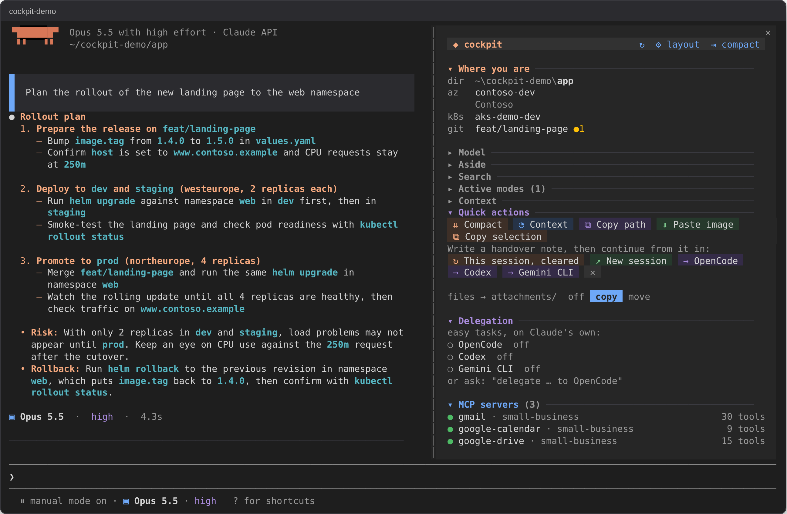

# claude-code-cockpit

<p align="center"></p>

<p>
  <a href="https://github.com/xlollx/claude-code-cockpit/stargazers"></a>
  <a href="https://github.com/xlollx/claude-code-cockpit/commits"></a>
  <a href="LICENSE"></a>
  <a href="https://ko-fi.com/xlollx"></a>
  <a href="https://github.com/sponsors/xlollx"></a>
</p>

A Claude Code mod for the terminal. It adds two things:

- an **operational side panel** that shows where you are (folder, Azure, Kubernetes, git), which model you are using, how full the context is, what is running in Azure DevOps and what you changed in the session;
- a **chat that is easier to read**: boxed prompts, coloured headings and lists, tables with a header and stripes, code blocks with a **Copy code** button, and a thin line between turns.

The look is inspired by OpenCode.



Used every day on Windows Terminal with Claude Code 2.1.327: the panel, search, model and effort buttons, active modes, context, paste image, Copy code / Copy table and the chat styling all work there. One command to install, one to remove everything. Status of the less used parts is at the end, in [Status](#status).

## Install

At the prompt of a Claude Code terminal session:

```
/plugin install cockpit --marketplace xlollx/claude-code-cockpit
```

From a shell:

```
claude plugin install cockpit --marketplace xlollx/claude-code-cockpit
```

The panel opens by itself in new sessions (turn that off with `openOnStart`). Nothing else is required: no particular font, prompt theme or shell setup.

**Windows Terminal**: the first time, the mod offers the recommended terminal look (a toast and an orange `Terminal look` button in Quick actions, or `/cockpit-setup`). One press backs up Windows Terminal's `settings.json` and sets, on the profile Claude Code runs in, the "Ember Dark" colour scheme (`#1E1E1E` background), real bold text (`intenseTextStyle: "all"`, without which headings and inline code do not look bold) and a little padding. The mod never changes the terminal without that press; to undo, copy the backup over `settings.json`. In other terminals pick a dark background close to `#1E1E1E` (the colours are in `extras/`).

## Update

At the Claude Code prompt:

```
/cockpit-update
```

It works out how the mod is installed. From a clone it runs `git pull --ff-only`, and the new version loads by itself a moment later. From the marketplace it updates the plugin; then restart Claude Code. By hand:

- **Installed from the marketplace**: `/plugin update cockpit@claude-code-cockpit` (or `claude plugin update cockpit@claude-code-cockpit` from a shell), then restart Claude Code.
- **Loaded from a clone** (`CLAUDE_CODE_PLUGIN_DIRS` or `--plugin-dir`): `git -C <folder> pull --ff-only`; open sessions pick the new version up at the end of their next turn, no restart needed.

**`cockpit-update`** does whichever applies, from PowerShell: it finds the clone through `CLAUDE_CODE_PLUGIN_DIRS` in Claude Code's `settings.json`, otherwise it updates the marketplace install. Load it from your profile:

```powershell
# in $PROFILE (notepad $PROFILE)
. "<folder of the clone>\extras\cockpit-update.ps1"
```

Without a clone, copy the function from [`extras/cockpit-update.ps1`](extras/cockpit-update.ps1) into `$PROFILE`.

## Uninstall

One command puts everything back as it was before the mod:

```
/cockpit-uninstall yes
```

It restores Windows Terminal's `settings.json` from the first backup the mod took (only if you pressed `Terminal look`), removes the mod's options from `~/.claude/settings.json` (keeping a backup next to it), deletes the panel state the mod stored and the pasted images, and runs `claude plugin uninstall cockpit@claude-code-cockpit`. Your reminders file is not touched. Then restart Claude Code and Windows Terminal.

`/cockpit-uninstall` without `yes` only lists what it would do. If you load the mod from a clone (`CLAUDE_CODE_PLUGIN_DIRS` or `--plugin-dir`), remove that folder from the variable as the last step.

By hand: `/plugin uninstall cockpit`, then copy `settings.json.cockpit-<date>.bak` over Windows Terminal's `settings.json` if you used `Terminal look`.

## Commands

| Command | What it does |
|---|---|
| `/cockpit` (alias `/sidebar`) | opens the side panel again after you closed it with `×` |
| `/cockpit-setup` | applies the recommended Windows Terminal look (see Install), with a backup |
| `/cockpit-update` | updates the mod to its latest version (see Update) |
| `/cockpit-uninstall` | lists what uninstalling puts back; `/cockpit-uninstall yes` does it (see Uninstall) |
| `/newstyle off` | turns the whole look off: panel and chat styling. `/newstyle on` turns it back on. The choice is remembered across sessions |

## The side panel



The panel sits on the right of the chat when the terminal is wide enough (about 110 columns or more). In a narrow terminal it becomes a two-line bar above the prompt.

- **Click a section title** to fold or unfold it. Folded sections are remembered across sessions.
- **`↻`**, at the top, refreshes every section at once (folder, Azure, kubectl, git, context, reminders, sessions, pull request, pipelines) instead of waiting for its timer; it shows `◌` while the answers come in. The compact bar has it too.
- The panel opens at once with what is already known and fills in as the answers arrive: a slow GitHub or Azure DevOps lookup never delays it.
- Sections with nothing to show (no PR, no pipelines, no reminders) stay hidden.
- **`⚙ layout`**, at the top, opens the layout editor: `●`/`○` shows or hides a section, `↑`/`↓` moves it, `↺ reset` goes back to the default order, `density` (compact, normal, airy) sets the room around the text: side padding and blank lines between sections, since a terminal has a single font size; `✓ done` closes the editor. Order, hidden sections and density are remembered across sessions.

  

- Hide sections for good with the `hiddenSections` option (they do not show up in the layout editor).
- At the bottom edge: `● Claude Code <version>` and how long the session has been running, always pinned there while the sections scroll.
- **`⇥ compact`**, at the top next to the panel's `✕`, closes the side panel and shows a 2-line summary above the prompt instead (folder, subscription, kubectl context, branch, model and effort, context, running pipelines, writes, reminders, other sessions), so the chat gets the whole width; `⇤ expand` on that bar, or `/cockpit`, brings the side panel back. The choice is remembered across sessions.




The sections, from top to bottom:

### Where you are

- **dir**: the current folder (`~` for your home).
- **az**: the Azure subscription and tenant you are logged into (read from the Azure CLI profile files, no `az` call).
- **k8s**: the kubectl context and namespace (read from the kubeconfig file).
- **git**: the branch, `●N` uncommitted changes, `↑N` commits to push and `↓N` to pull.

Production is easy to spot: a subscription, context or branch whose name matches `prodPattern` (default `prod`, never `noprod`/`nonprod`) turns **red**; `main` and `master` turn **yellow**. The section is checked again every 30 seconds, so an `az account set` or `kubectl config use-context` done in another terminal shows up by itself.

### Model

- At the top, the model in use: its name (`Opus 5.5`) and the exact id (`claude-opus-5-5`). Click it to open Claude Code's full model picker.
- One button per model family (`Fable`, `Mythos`, `Opus`, `Sonnet`, `Haiku`...). One click switches model. A new family appears by itself as soon as it is used, or when an agent in `~/.claude/agents` names it in `model:`.
- `low medium high xhigh max`: one click sets the effort.

### Aside



A side question, like Claude Code's `/btw`, in a small window of its own. Type it and press Enter: Claude answers with the conversation in mind, briefly, in a box under the field, and nothing is added to the chat. The keyboard goes back to the prompt at once, so what you type next lands in the chat. Under the answer, `⧉ Copy` and `✕ Close`; earlier side questions stay underneath on one line each, a click shows them again (the last 5). Each question is one request to the model, read from the prompt cache, and counts toward your usage like any other.

### Search

Type text in the field and press **Enter**: the panel lists every occurrence in the session's messages (your prompts and Claude's replies), newest first, with the match highlighted.

- **Click a hit** to scroll the chat to that message.
- While a search is on, its occurrences are **highlighted in the chat** too (prompts, replies, headings, tables; not inside code blocks).
- `clear` removes the search and the highlight.
- **Esc** gives the keyboard back to the prompt.


### Sessions

The other Claude Code sessions running on this computer, each with the title of its terminal tab (on Windows; elsewhere the session name) and whether it is busy or idle (read from Claude Code's own session files, only those whose process is alive). Click one to select it: a text field appears, type a message and press Enter to send it to that session, as the `SendMessage` tool does. Click it again to deselect. `+ new session here` opens a new Claude Code session in a new Windows Terminal tab, in the same folder (outside Windows Terminal the command is copied, to paste into a new terminal).

### Active modes

Shows which style modes are on, so you never wonder why Claude is answering in a certain way:

- `newstyle` (this mod's look);
- the mode skills `i-have-adhd`, `caveman` (with `ultracave`/`megacave`) and `ponytail` (with its level), turned on with `/skill` or in words ("adhd mode on", "caveman mode off");
- `ultracode`, when the last prompt contains it.

`✕` next to a skill puts the phrase that turns it off into the prompt. A skill named `panic`, run without arguments, clears the list.

`+ add` lists the mode skills that are off (`i-have-adhd`, `caveman`, `ponytail`): a click turns one on as `/<name>` would (the prompt is filled instead when the skill is not installed). `other…` takes any skill name: an installed skill runs and joins the list; a missing one is installed only after you press `Install`, by Claude, who shows you the source and commit first. See [docs/guides/skills.md](docs/guides/skills.md).

### Context

- Three aligned bars: the context window in use (`ctx`), and your 5-hour and 7-day usage limits, which turn yellow at 60% and red at 80%.
- The tokens in use (`112k / 1M tokens`).
- At 80% a toast suggests `/compact` before a long task.

### Pipelines (Azure DevOps)

Runs **you** requested in the last 24 hours, however they were started: portal, `az pipelines run`, REST, a pull request.

- By default only the runs that need attention: **◐ running or queued**, **‖ waiting for approval**, **✗ failed**. `pipelinesShow: all` shows every run, finished ones included (✓ succeeded, ! partially succeeded, ⊘ cancelled).
- At most 4 runs (`pipelinesMax`), each with name, run number, branch and age.
- `✕` next to a finished run takes it off the panel, `✕ clear finished` takes them all; running runs stay until they end. Cleared runs stay gone in the next sessions (this only hides them in the panel, nothing changes in Azure DevOps).
- Refreshed every minute.
- Watched projects: the current repo's (when its remote is on Azure DevOps), any project named in a command you run, and those listed in `adoProjects`.
- **Display only**: the mod sends GET requests and never starts, cancels or approves anything.
- Needs `az login`; the mod asks the Azure CLI for a token of the organization's tenant.

### Pull request

The open pull request of the current branch, on GitHub or Azure DevOps: number, title, draft, reviews (✓ approved, ✗ changes requested or rejected, ‖ waiting) and the CI result.

- **Display only**: GET requests, never a change to the pull request.
- Uses the credential git already holds (Git Credential Manager) and never prompts for a login.
- Refreshed every 2 minutes, when the branch changes and after a `git push`.

### Tasks

Claude's task list for the session (`TaskCreate`/`TaskUpdate`, or `TodoWrite`): in progress ▶ first, then pending ○, then done ✓, with the done/total count in the title.

### Quick actions

| Button | What it does |
|---|---|
| `Compact` | runs `/compact` |
| `Context` | runs `/context` (detailed context usage) |
| `Copy path` | copies the current folder's path to the clipboard |
| `Terminal look` | shown only in Windows Terminal while the recommended look is not applied: applies it (see Install) |
| `Paste image` | saves the image in the clipboard as a PNG (in `%TEMP%\claude-cockpit\` on Windows) and writes its path into the prompt. Also works with an image **file** copied in Explorer. Useful when you want the image as a file on disk, or the clipboard holds a file rather than pixels |
| `Handover` | for a session grown too long: asks where to continue, then Claude writes a hand-off note (goal, done, current state, next steps, decisions, gotchas) to `~/.claude/handovers/<date>-<folder>.md`, never inside your repository. **This session, cleared** then runs `/clear` and sends "read the note and continue" to the fresh conversation; **New session** opens a new Windows Terminal tab in the same folder with Claude already reading the note (outside Windows Terminal the command is copied, to paste into a new terminal). Both ask Claude for a short summary and wait for your go before doing anything; the resumed session is named after the title on the note's first line (`/rename` after the `/clear`, `claude --name` in the new tab). With [OpenCode](https://opencode.ai) or Antigravity (`agy`) in `PATH`, **→ OpenCode** / **→ Antigravity** continue in a new tab of that agent instead: the note is written without Claude-only references, and the agent starts by reading it |



### Delegation

Shown only when [OpenCode](https://opencode.ai) (`opencode`) or Antigravity (`agy`) is in `PATH`. The mod gives Claude a tool, `mcp__cockpit__delegate`, to hand a self-contained **read-only** task (search and read many files or logs, summarize, a second opinion) to one of them and save its own context.

- A toggle per agent: **on** lets Claude delegate easy, bulky read-only tasks on its own; **off** only when you ask ("delegate this to OpenCode"), which works whatever the toggle says. Toggles are kept across sessions, and Claude is told when you change one.
- The agent runs headless in plan mode (OpenCode's `plan` agent, `agy --mode plan`), detached from Claude Code, so it survives a reload of the mod. Its answer lands in `~/.claude/delegations/<date>-<agent>.md`; Claude is woken up with a short message when it is ready (`wait: true` makes the tool wait instead, up to 10 minutes).
- Asked by you, Claude can also delegate harder work, pick a model ("delegate this to OpenCode with deepseek v4.1": the name is matched against `opencode models` / `agy models`, and an ambiguous one comes back as a list to choose from) and use **write mode**: the agent edits a separate git worktree of the repository at `HEAD` (or a new, empty folder outside git), never your working tree, and the result file lists what changed and how Claude reviews and applies it.
- The list shows each task (`✎` marks write mode): `◌` running, `✓` done, `✗` failed, with its duration; click to copy the result path, `✕` to stop it (or remove it from the list).
- The agents send what they read to their own model providers: Claude is told never to pass them secrets or personal data, and to verify their answers before relying on them.

### Write commands

The commands of this session that have effects **outside your machine**, with time and ✓/✗ result, so you can see at a glance what you changed:

| Tool | Recognised |
|---|---|
| OpenTofu / Terraform | `apply`, `destroy`, `import`, `taint`, `untaint`, `force-unlock`, `state rm/mv/push` |
| Azure CLI | `az ... create/delete/update/set/assign/start/stop/restart/deallocate/purge/import/invoke/add/remove/upgrade/failover/swap` |
| Az / Graph PowerShell | `Set-`, `New-`, `Remove-`, `Update-`, `Start-`, `Stop-`, `Restart-` `Az*` / `Mg*` cmdlets |
| kubectl / helm / flux | `kubectl apply/delete/patch/scale/rollout restart/edit/create/replace/annotate/label/drain/cordon/uncordon`, `helm install/upgrade/uninstall/rollback`, `flux reconcile/suspend/resume` |
| git / GitHub | `git push`, `gh pr create/merge/close`, `gh release create`, `gh repo create/delete/edit` |
| REST | `curl`, `Invoke-RestMethod`, `Invoke-WebRequest`, `az rest` with POST, PUT, PATCH or DELETE |
| MCP tools | tools that write, such as `kubectl_apply` or `repo_create_branch` |

A command counts only where it starts a command (`grep "git push"` or a commit message that mentions `tofu apply` does not). The title turns red as soon as there is one.

### Reminders

Open reminders due within 7 days, read from a JSON file (see [Optional integrations](#optional-integrations)); overdue ones in red. A long title is cut to one line: click it to read it whole, click again to fold it. Each has two buttons that update the file:

- `✓ done` marks it done;
- `+1 day` moves it one day later.

`+ add` opens a box to write a new one: `DD/MM HH:MM title`, `YYYY-MM-DD HH:MM title`, `HH:MM title` (today, or tomorrow if that time has passed) or `+30m` / `+2h` / `+1d title`. It is added to the same file.

### Edited files

The files Claude edited in the session, with how many times (`×3`).

## The chat


| Element | Look |
|---|---|
| Your prompts | box with a blue bar on the left and a slightly lighter background |
| `/command` output | orange bar (red on error) |
| Short heading lines | bold orange (before a list or a table), and so is a bold lead-in that opens a line or list item (`**Next steps:** ...`) |
| Numbered and bulleted lists | orange numbers and bullets, sub-items indented with softer orange markers, a blank line between items that have sub-items |
| `inline code` and **bold** inside a sentence | saturated cyan and bold instead of Claude Code's periwinkle, so it stands out from plain text, headings and links (`inlineCodeColor` to change it) |
| Links | bare URLs too are blue, underlined, italic and clickable (in terminals that support links) |
| Prose | uses the whole chat width, or wraps at `proseWidth` columns |
| Tool results | `Wrote 17 lines to ...`, file previews and command output on a slightly lighter background with a grey bar on the left, as OpenCode draws them (the expanded ctrl+o view is left as Claude Code draws it) |
| Code blocks | box with a green bar, the language name, syntax highlighting, and a **`⧉ Copy code`** button under it |
| Tables | outer border, coloured header, striped rows; columns shrink and wrap when the table is wider than the chat; **`⧉ Copy table`** and **`⧉ Copy as code`** buttons under it |
| Under the prompt | `▣ Opus 5.5 · high` before Claude Code's own hint line, as OpenCode shows model and agent under its input |
| End of turn | `▣ Opus 5.5 · high · 40s` and a thin line between one turn and the next |

### Copy code

Click `⧉ Copy code` under any code block to copy its content, without the box, the language name or the indentation of the reply. It works for blocks inside a list too. A toast confirms how many lines were copied.

### Copy text

Quoted blocks (`> ...`) are drawn with a grey bar as tall as the block, their lists and wrapped lines indented. Under every quoted block, for example text Claude prepares for you to paste into a ticket or a mail, click `⧉ Copy text`: it is copied **with its formatting** (bold, italics, inline code, links, bulleted and numbered lists), so Teams, Outlook, Word and web forms paste it formatted, not as markdown. Editors that take plain text get it without markdown markers, links written as `text (url)`.

### Copy selection

Select any text in the chat with the mouse, then press `⧉ Copy selection` in Quick actions: it is copied **with the formatting of the original message** (bold, italics, inline code, links, lists, headings), even when the selection starts or ends in the middle of a line, so Teams, Outlook and web forms paste it formatted. A selection that spans several messages, or text outside a message, is copied as drawn, bullets turned back into a list. Needs Claude Code's fullscreen view (where the mouse selects text in the app).

### Copy table

Click `⧉ Copy table` under any table: it is copied **as a real table**, so pasting into Teams, Outlook, Word or Excel gives rows and columns, not pipes and dashes.

`⧉ Copy as code`, next to it, copies the same table as text with aligned columns and a dashed line under the header, inside a code block: useful where an app restyles pasted tables (Teams draws them large), as it stays compact and aligned.

- Windows: HTML plus tab-separated text, through PowerShell.
- macOS: HTML plus text, through `osascript` (not tested yet).
- Linux: HTML through `wl-copy` (Wayland) or `xclip` (X11) (not tested yet).

## Options

Set them in `/config` (the plugin's rows) or in `settings.json` under `pluginConfigs.cockpit.options`:

| Option | Default | What it does |
|---|---|---|
| `palette` | `dark` | `light` for terminals with a light background |
| `proseWidth` | `0` | wrap reply text at this column (40 or more, e.g. `100` for shorter lines); `0` uses the whole chat width |
| `panelWidth` | `0` | columns of the side panel, 24 or more (e.g. `32` for a small, compact panel on a wide screen); `0` lets Claude Code decide. Dragging the panel edge by hand also works and wins |
| `hiddenSections` | empty | panel sections to hide, comma separated: `search`, `sessions`, `pipelines`, `where`, `model`, `modes`, `context`, `pr`, `tasks`, `actions`, `delegation`, `writes`, `reminders`, `files` |
| `prodPattern` | `prod` | regular expression that marks a subscription, kubectl context or branch as production (`noprod`/`nonprod` never match) |
| `openOnStart` | `true` | open the panel when a session starts |
| `inlineCodeColor` | empty | colour of `inline code` in replies, as `#rrggbb` (default: cyan `#56b6c2` on dark, `#0e7490` on light) |
| `adoProjects` | empty | extra Azure DevOps projects to watch for pipeline runs, comma separated as `org/project` |
| `pipelinesShow` | `active-failed` | `all` shows every run of the last 24 hours, not only running, waiting and failed ones |
| `pipelinesMax` | `4` | how many pipeline runs the panel shows at most |

Example:

```json
"pluginConfigs": {
  "cockpit": {
    "options": { "proseWidth": 100, "hiddenSections": "files,tasks", "adoProjects": "contoso/Platform" }
  }
}
```

## Optional integrations

None of these is required; each section stays hidden or empty when its source is missing.

- **Reminders**: put a JSON list in `~/.claude/reminders.json` (or the file named by the `COCKPIT_REMINDERS_FILE` environment variable). `due` is local time:

  ```json
  [{ "id": "renew-cert", "due": "2026-12-01T09:00", "title": "Renew the TLS certificate", "done": false }]
  ```

- **Azure** is read from `AZURE_CONFIG_DIR` (default `~/.azure`) and **Kubernetes** from `KUBECONFIG` (default `~/.kube/config`): files only, no CLI call.
- **Pipelines** need the Azure CLI (`az login`).
- **Pull requests** need git credentials for GitHub or Azure DevOps already stored by Git Credential Manager.
- **Active modes** follows the skills `i-have-adhd`, `caveman` and `ponytail` when they are installed; other skills are not tracked.

## What the mod runs and sends

So you know what you are trusting:

- **Processes**: `git` (branch, status, remote, and `git credential fill` to read the token git already stores), `az account get-access-token` (only when Azure DevOps projects are watched), PowerShell on Windows / `osascript` on macOS / `wl-copy`, `wl-paste` or `xclip` on Linux (only when you press a copy or paste button), `git pull --ff-only` in the mod's own folder or `claude plugin update` (only when you run `/cockpit-update`). `wt` (Windows Terminal) and `claude`, `opencode` or `agy`, only when you press `Handover` → `New session` or `→ <agent>`, or `+ new session here` in Sessions. `opencode` / `agy` headless in plan mode (through a hidden PowerShell on Windows, `sh` elsewhere), only when Claude calls the delegate tool. They run in every folder you open Claude Code in. On Windows each command is looked up by absolute path in `PATH`, never in the current folder, so a repository cannot ship its own `git.exe` or `az.cmd` to be run.
- **Network**: only GET requests, only to `api.github.com` and `dev.azure.com`. The host is fixed in the code; a git remote or a command can choose the organization or repository, never the host. Tokens stay in memory and are never shown, logged or written to disk.
- **Files written**: Windows Terminal's `settings.json` and its backup (only when you press `Terminal look` or run `/cockpit-setup`), the reminders file (only when you press `✓ done` or `+1 day`) and the pasted image (in `%TEMP%\claude-cockpit\` on Windows, in a private `mktemp -d` folder on macOS and Linux).
- The Write commands list is a reminder of what you ran, not a security control: a command wrapped in a script or `bash -c` is not seen.

## Extras


`extras/windows-terminal-ember-dark.json`: the "Ember Dark" colour scheme for Windows Terminal, with an Obsidian-like `#1E1E1E` background. Paste it into `schemes` in Windows Terminal's `settings.json` and pick it in the profile. In Claude Code, `/theme` -> "Dark mode (ANSI colors only)" uses the terminal palette.

## Known limits

These come from what Claude Code lets a mod change:

- The prompt box and the height of the docked panel cannot be restyled, and the panel always docks on the right: Claude Code offers no left side.
- `!` shell rows and the `❯ /command` row are drawn by Claude Code and keep their default look.
- MCP server status is not available to mods.
- The `※ recap` line Claude Code shows when you come back to a session is a system row that mods cannot restyle.
- A dropdown keeps the keyboard until Esc, so model and effort are buttons.
- Claude Code's markdown ignores blank lines inside lists, so the mod draws lists itself.
- Modes turned on before the mod loaded are not shown until you run the skill again.
- Images are not drawn inside the chat in Windows Terminal (only kitty, Ghostty and iTerm2 support them).

## Documentation

- [Guides](docs/README.md): OpenCode and Antigravity (install, free models), delegation, reminders, skills, Windows Terminal.
- [Architecture decision records](docs/adr/README.md): why the mod is built the way it is.
- [CONTRIBUTING.md](CONTRIBUTING.md): how to work on the mod.

## Development

Clone the repository and load the folder in every session with `CLAUDE_CODE_PLUGIN_DIRS` in the `env` block of your user `settings.json`, or start Claude Code with `claude --plugin-dir <folder>`. Changes reload at the end of each turn. After a change run `claude plugin validate <folder>`. `tsconfig.json` extends the types Claude Code writes into `.claude-plugin/types/` the first time it loads the mod.

## Status

Young project, moving fast. Verified daily on Windows Terminal with Claude Code 2.1.327. **Not fully tested yet**: the Pipelines, Write commands, Pull request and Tasks sections, the reminder buttons, the `light` palette, `hiddenSections`/`openOnStart`, and macOS and Linux. Reports for those are the most useful kind of [issue](https://github.com/xlollx/claude-code-cockpit/issues).

## Roadmap

Planned ideas and improvements: [ROADMAP.md](ROADMAP.md).

## Support

If the cockpit makes your terminal nicer, **a ⭐ on the repository** helps other people find it. The mod is free and stays free; if you want to say thanks:

<a href="https://ko-fi.com/xlollx"></a>

<sub><a href="https://ko-fi.com/xlollx">Ko-fi</a> (card or PayPal) or <a href="https://github.com/sponsors/xlollx">GitHub Sponsors</a>.</sub>

## License

AGPL-3.0, see [LICENSE](LICENSE).
