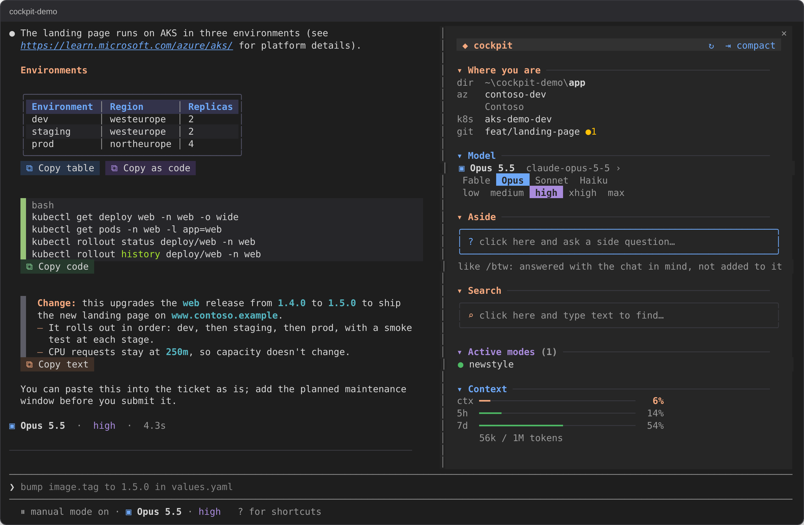

# claude-code-cockpit

A Claude Code mod for the terminal: an operational side panel that shows where you are and what you changed, and a chat that is easier to read. The look is inspired by OpenCode.


## What it does

### Side panel (`/cockpit`, alias `/sidebar`)

| Section | Shows |
|---|---|
| Where you are | folder, Azure subscription and tenant, kubectl context and namespace, git branch with uncommitted changes ● and commits ↑ to push / ↓ to pull (red when it looks like production) |
| Model | one button per model family (`Fable`, `Mythos`, `Opus`, `Sonnet`, `Haiku`...) and `low medium high xhigh max`: one click applies it. New families appear by themselves as soon as they are used, or when an agent in `~/.claude/agents` names them in `model:`; `…` opens Claude Code's full model picker |
| Active modes | `newstyle` and the session's mode skills (`i-have-adhd`, `caveman`, `ponytail` + level), plus `ultracode` when the last prompt contains it; `✕` puts the phrase that turns a skill off into the prompt |
| Context | fill bar, tokens, 5-hour and 7-day limits, session duration; a warning at 80% |
| Pull request | the open PR of the current branch on GitHub or Azure DevOps: number, title, draft, reviews (✓ approved, ✗ changes requested / rejected, ⏸ waiting) and CI result. Display only: the mod sends GET requests and never changes the pull request. Uses the credential git already holds (Git Credential Manager), never prompts; refreshed every 2 minutes, on branch change and after a push |
| Tasks | Claude's task list for the session (`TaskCreate`/`TaskUpdate`, or `TodoWrite`): in progress ▶ first, then pending ○, then done ✓, with the done/total count |
| Quick actions | `Compact`, `Context`, `Copy path`, `Paste image` (saves the clipboard image, or a file copied in Explorer, and puts its path in the prompt: no need to save or drag a file) |
| Write commands | commands with effects outside your machine: `tofu`/`terraform apply`, `az ... create/delete/set`, `kubectl apply/delete`, `helm`, `flux`, `git push`, `gh pr create`, REST writes, and MCP tools that write (kubectl_apply, repo_create_branch...) |
| Reminders / Files | reminders due within 7 days (optional, see below) with `✓ done` and `+1 day` buttons that update the file, files edited in the session |

- Click a section title to fold or unfold it (remembered across sessions).
- In a wide terminal the panel sits on the side; in a narrow one it becomes a two-line bar above the prompt.

### Chat



| Element | Style |
|---|---|
| Your prompts | box with a blue bar and dark background |
| `/command` output | orange bar (red on error) |
| Replies | short heading lines in bold orange, lists drawn with coloured numbers and a blank line between items that have sub-items, prose wrapped at 100 columns |
| Code blocks | box with a green bar, language name, syntax highlighting |
| Tables | outer border, coloured header, striped rows; columns shrink and wrap when the table is wider than the chat |
| `⧉ Copy table` | under every table: copies it as HTML, so Teams, Outlook, Word and Excel paste a real table. Windows: HTML + tab-separated text through PowerShell. macOS: HTML + text through `osascript`. Linux: HTML through `wl-copy` or `xclip` (macOS and Linux not tested yet) |
| End of turn | `▣ Opus 5.5 · high · 40s` and a thin line between one turn and the next |

`/newstyle on|off` turns the whole look on or off (remembered across sessions).

## Install

At the prompt of a Claude Code terminal session:

```
/plugin install cockpit --marketplace xlollx/claude-code-cockpit
```

From a shell:

```
claude plugin install cockpit --marketplace xlollx/claude-code-cockpit
```

The panel opens by itself in new sessions; `/cockpit` opens it again if you close it.

### Development

Clone the repository and load the folder in every session with `CLAUDE_CODE_PLUGIN_DIRS` in the `env` block of your user `settings.json`, or start Claude Code with `claude --plugin-dir <folder>`. After a change run `claude plugin validate <folder>`. `tsconfig.json` extends the types Claude Code writes into `.claude-plugin/types/` the first time it loads the mod.

## Optional integrations

None of these is required; each section stays hidden or empty when its source is missing.

- **Reminders**: put a JSON list in `~/.claude/reminders.json` (or the file named by `COCKPIT_REMINDERS_FILE`) and the panel shows the open ones due within 7 days (red when overdue):

  ```json
  [{ "id": "renew-cert", "due": "2026-12-01T09:00", "title": "Renew the TLS certificate", "done": false }]
  ```

- **Active modes** follows these skills when they are installed: `i-have-adhd`, `caveman` (with `ultracave` and `megacave`), `ponytail` (with its level). A skill named `panic`, run without arguments, clears the list. Other skills are not tracked.
- **Azure and Kubernetes** are read from `AZURE_CONFIG_DIR` (default `~/.azure`) and `KUBECONFIG` (default `~/.kube/config`): files only, no CLI call.
- **Production highlight**: subscription, kubectl context and branch turn red when the name contains `prod` (but not `noprod` or `nonprod`), and `main`/`master` turn yellow.

## Extras

`extras/windows-terminal-ember-dark.json`: the "Ember Dark" colour scheme for Windows Terminal (paste it into `schemes` in Windows Terminal's `settings.json`). In Claude Code, `/theme` -> "Dark mode (ANSI colors only)" uses the terminal palette.

## Known limits

These come from what Claude Code lets a mod change:

- The prompt box and the height of the docked panel cannot be restyled.
- `!` shell rows and the `❯ /command` row are drawn by Claude Code and keep their default look.
- MCP server status is not available to mods.
- A dropdown (`Select`) keeps the keyboard until Esc, so model and effort are buttons.
- Claude Code's markdown ignores blank lines inside lists, so the mod draws lists itself.
- Modes turned on before the mod loaded are not shown until you run the skill again.

## Roadmap

Planned ideas and improvements: [ROADMAP.md](ROADMAP.md).

## License

AGPL-3.0, see [LICENSE](LICENSE).
